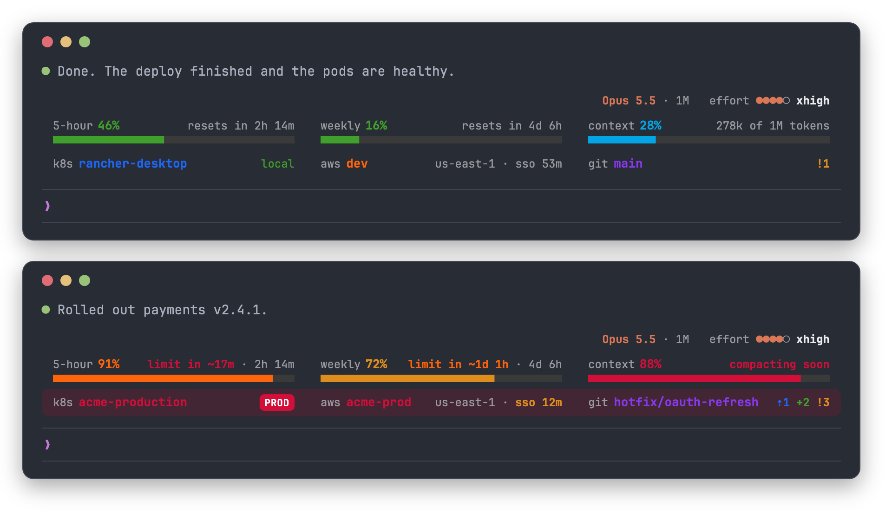
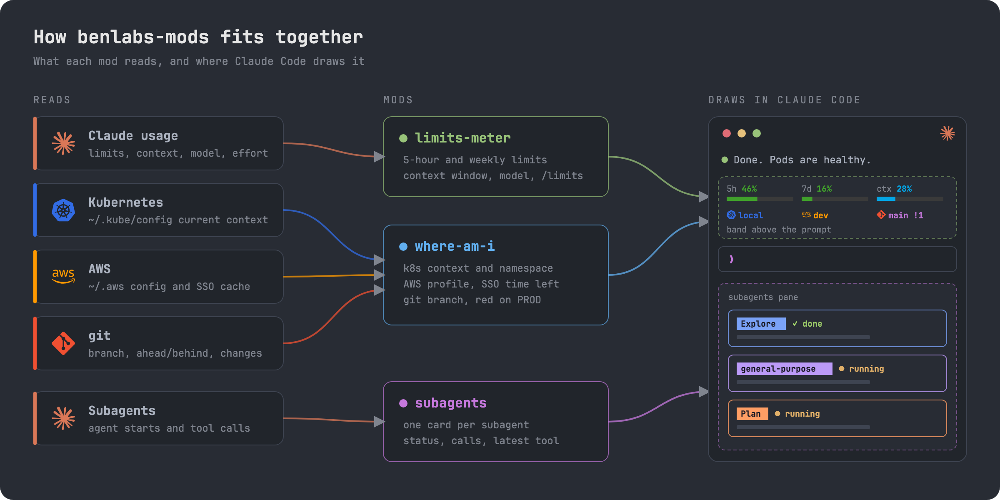
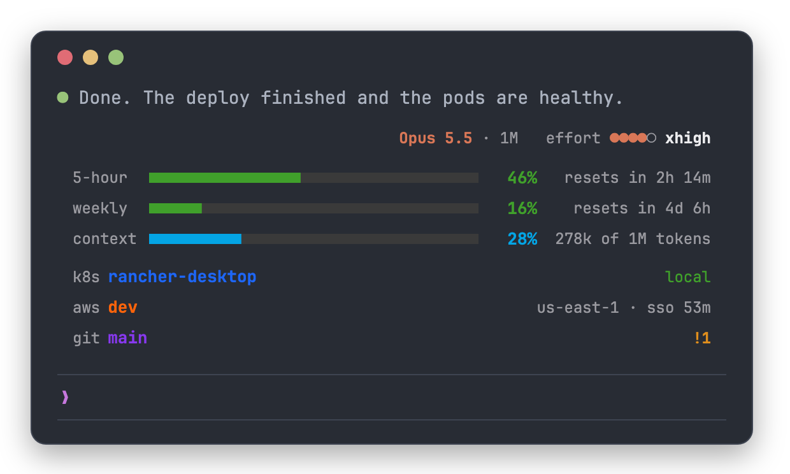
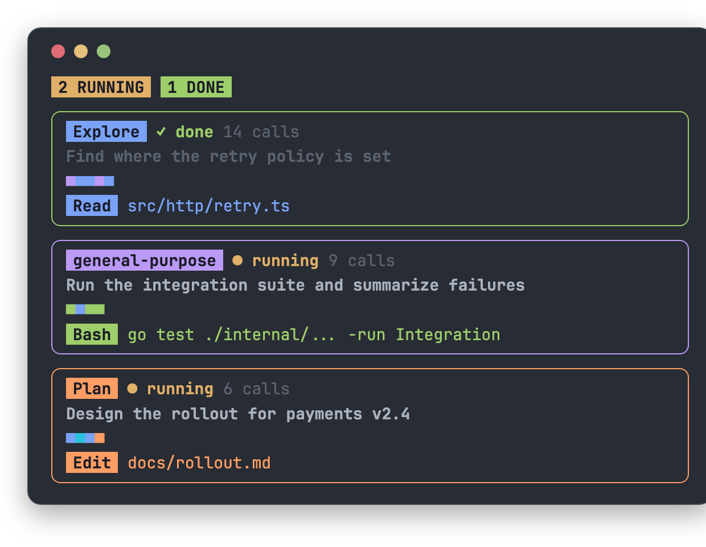

# benlabs-mods

Claude Code mods for the terminal and the desktop app: your usage limits,
context window and model; the Kubernetes context, AWS profile and git branch
you are pointed at, with a red banner on production; and a live pane of your
subagents.



| Mod | What it does |
| --- | --- |
| [limits-meter](limits-meter/) | 5-hour and weekly usage limits, this session's context window, and the model with its effort, with pace warnings, alerts at 80% and 95%, and `/limits` |
| [where-am-i](where-am-i/) | Kube context and namespace, AWS profile with SSO time left, and git branch with its marks; a red `PROD` banner on production; `/where` |
| [subagents](subagents/) | A pane that opens when a subagent starts: one card per subagent with its task, status, call count and latest tool call |

## How it fits together



The bands stack above the prompt, limits-meter's over where-am-i's, on the
same three columns. In a narrow pane each meter takes a row of its own:



The subagents pane, one card per subagent:



## Install

At the prompt of a Claude Code terminal session:

```text
/plugin install limits-meter --marketplace luisgb14/benlabs-mods
/plugin install where-am-i --marketplace luisgb14/benlabs-mods
/plugin install subagents --marketplace luisgb14/benlabs-mods
```

Or from a shell:

```sh
claude plugin marketplace add luisgb14/benlabs-mods
claude plugin install limits-meter@benlabs-mods --scope user
claude plugin install where-am-i@benlabs-mods --scope user
claude plugin install subagents@benlabs-mods --scope user
```

User-scope plugins load in every terminal session, in the desktop app's Code
tab and in VS Code. Start a new session, or run `/reload-plugins`, to see them.

## Update

```sh
claude plugin marketplace update benlabs-mods
claude plugin update limits-meter@benlabs-mods
```

The desktop app runs the copy made at install: quit it with Cmd+Q and start a
new session after an update.

## Troubleshooting

- **Nothing shows.** Sessions open before the install don't load it. Start a
  new one, or run `/reload-plugins`, then check `claude plugin list`.
- **Usage limits appear after Claude's first reply.** Claude Code only reports
  limits with a reply, and only for Pro and Max sign-ins.
- **No k8s column.** where-am-i shows the kubeconfig's current context; with
  none set (`kubectl config current-context` errors) there is nothing to show.
- **Hide one.** `/limits hide` or `/where hide` hides that band in every
  session; `show` brings it back.

## Develop

```sh
claude plugin validate .
claude plugin test limits-meter
claude plugin test where-am-i
claude plugin test subagents
```

## License

[MIT](LICENSE). The Kubernetes, AWS, git and Claude logos in the diagram come from
[Simple Icons](https://simpleicons.org) (CC0) and belong to their owners.
