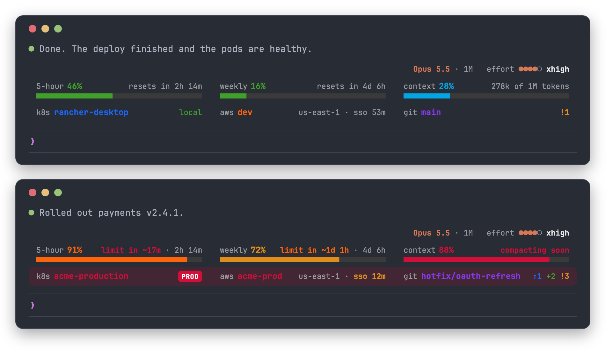

# limits-meter

A Claude Code mod that shows your Claude plan's **5-hour** and **weekly**
usage limits, this conversation's **context window**, and the **model** with
its **effort**, above the prompt in every session.



- **Terminal:** three columns, one per meter: the label and percentage over a
  solid bar, with the reset time (or the context's tokens) at the right. A
  column says more only when something needs attention: *tight pace*,
  *limit in ~1h 10m*, *limit reached*, *filling up*, *compacting soon*. Limits
  go green, amber, orange, then red as they fill; the context is blue until it
  nears auto-compaction. The colors are the same deep set on dark and light
  themes. where-am-i lines up under the same columns. Below 80 columns it is
  one row per meter. `/limits big` switches to large pixel digits
  (`/limits small` switches back).
- **Desktop app (Code tab):** the same design, drawn as an image: the three
  columns with rounded bars, the same words and colors, and one row per meter
  in a narrow pane. It follows the app's light and dark mode, lines up with
  where-am-i's card, and scales down when the pane is narrower than drawn.
- **Context window:** a third panel with how full this conversation is,
  measured like `/context` against the window it auto-compacts in
  (`43k of 500k tokens`). It shows from the start of a session: until the
  first reply the count is a local estimate, marked `~`. It turns amber
  (*filling up*) 70% of the way to auto-compaction and red (*compacting soon*)
  at 90%. `/limits` also prints where it compacts. The
  count is the tokens Claude's last reply reported, the figure auto-compaction
  goes by, so `/context`, which counts category by category, can read a few
  thousand lower. It belongs to each conversation, resets on `/clear` and
  after a compaction, and shows on its own with an API key (no limits).
- **Model and effort:** the top line, over the context column, names the
  session's model (`Opus 5.5 · 1M`) and its effort as five dots
  (`effort ●●●●○ xhigh`). The effort comes from your settings until the first
  reply reports the level the turn actually ran at; `/effort` and `/model`
  update it at once. Settings are read the way Claude Code reads them:
  `modelSettings` under the exact model id (`claude-opus-5-5`) or its alias
  (`opus`, `opus[1m]`). A key like `claude-opus-5` matches neither, so Claude
  Code ignores it too, and the caption shows only the model until the first
  reply.
- **Pace:** when your current rate would run out well before the reset, the
  column says when (*limit in ~1h 10m*); a rate that ends close to the limit
  says *tight pace*. The desktop card says the same.
- **Shared across sessions:** the latest reading is cached, so a new session
  shows it right away and picks up readings that other open sessions saw.
  `/limits` and the big layout show the age of a reading more than 5 minutes
  old.
- **Alerts:** a toast when a limit crosses 80% and again at 95%, once per
  limit per reset period, across all sessions.
- **`/limits`** prints the readout. `/limits hide` and `/limits show` turn the
  band off and on everywhere; `/limits big` and `/limits small` pick the size.
- **VS Code panel and mobile** don't draw the band, so there it pins a
  one-line status with colored dots instead.

Limits are only reported for Pro and Max sign-ins, and only after Claude's
first reply in a session.

## Install

```text
/plugin install limits-meter --marketplace luisgb14/benlabs-mods
```

See [../README.md](../README.md) for the rest.

## Develop

| File | Role |
| --- | --- |
| `hooks/register.tsx` | Hooks: session start, limit readings, `/limits`, drawing the band |
| `hooks/meter.ts` | Shared math: colors, countdowns, pace |
| `hooks/band.ts` | The terminal band: palette, columns, the model caption, and what fits in each |
| `hooks/model.ts` | Model names, effort levels, and the effort settings give a model |
| `hooks/term.ts` | Terminal drawing: pixel digits and bars |
| `hooks/card.ts` | Desktop card, as SVG |
| `types/index.d.ts` | The mod's state contract |

Edits load with `/reload-plugins`. Verify from the repo root:

```sh
claude plugin validate limits-meter
claude plugin test limits-meter
```
