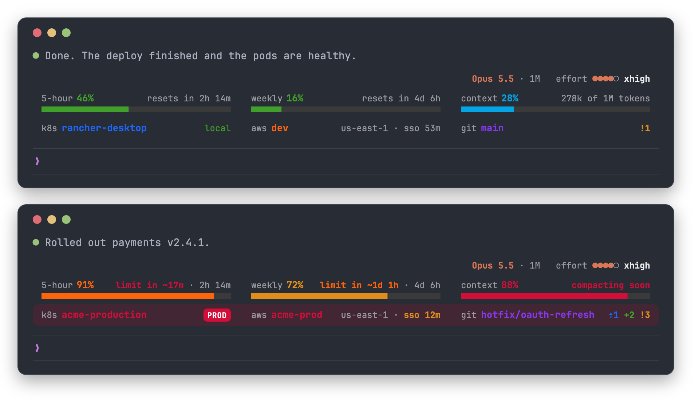

# where-am-i

A Claude Code mod that keeps your Kubernetes context, AWS profile and git
branch above the prompt in every session. When anything points at
production, the line turns into a red banner with a `PROD` badge, in the
terminal and the desktop app alike, so it's impossible to miss.



| Part | What it shows | Where it comes from |
| --- | --- | --- |
| Kubernetes | Current context (an EKS ARN is shortened to the cluster name) and namespace | `~/.kube/config`, or the files in `$KUBECONFIG` |
| AWS | Profile, region, and time left on the SSO login | `$AWS_PROFILE` (else `default`), `~/.aws/config`, `~/.aws/sso/cache/` |
| Git | Branch, with the marks your prompt uses: `⇣2` to pull, `⇡1` to push, `~1` conflicts, `+3` staged, `!2` modified, `?1` untracked | `git status` in the session's folder |

- **Layout:** one line on limits-meter's three columns, so Kubernetes, AWS and
  git sit under the 5-hour, weekly and context meters. The details at the right
  of each part shorten or drop to keep names whole, except a `PROD` badge,
  git's marks and an SSO login about to expire, which stay and clip the name
  instead. Below 80 columns the parts share one line, or take a row each. The
  desktop app draws the same line as an image, under limits-meter's card.
- **Environment:** the most dangerous environment that any of these names
  points at. Production turns the whole line into a red banner, with a red
  `PROD` badge beside the cluster. `STAGING`, `DEMO`, `LAUNCH`, `UAT` and
  `PREPROD` get an amber badge. Safe environments (`sandbox1`, `devint`, `qa`,
  `dev`) and clusters on this machine (`rancher-desktop`, `docker-desktop`,
  `kind`, `minikube`, `orbstack`...) show their word in green, such as
  `local`. Names are matched as whole words, so `devops-admin` and
  `productivity` don't count.
- **Colors:** Kubernetes in blue, AWS in orange, git in purple, from
  limits-meter's palette, the same on dark and light themes. Red or amber
  replaces them whenever a name points at production or staging.
- **SSO** turns amber in its last 30 minutes and red once it has expired.
- **Updates** every 15 seconds, after every shell command Claude runs, and
  when the session changes folder.
- **`/where`** prints the full details: the whole context name and how much
  is left on SSO. `/where hide` and `/where show` turn the band off and on
  everywhere.
- **Stacks** with the other mods' bands, such as limits-meter, instead of
  replacing them.

It reads the kube and AWS config files directly and never runs `kubectl` or
`aws`, so it also works in the desktop app, which doesn't get your shell's
`PATH`. The AWS profile is the one Claude Code was started with. A profile
set inside a single command (`AWS_PROFILE=x aws ...`) only lasts for that
command, so the band can't see it.

## Your environment names

The patterns are at the top of `hooks/probe.ts`: `CAUTION`, `PROD` and
`SAFE`. Edit them to match how your clusters and profiles are named, then run
`/reload-plugins`.

## Install

```text
/plugin install where-am-i --marketplace luisgb14/benlabs-mods
```

See [../README.md](../README.md) for the rest.

## Develop

| File | Role |
| --- | --- |
| `hooks/register.tsx` | Hooks: refresh triggers, `/where`, drawing the band in the terminal |
| `hooks/band.ts` | The terminal line: palette, columns, and what fits in each |
| `hooks/probe.ts` | Parsers for kubeconfig, AWS config, the SSO cache and git status; environment names |
| `hooks/draw.ts` | The desktop card, as SVG |
| `types/index.d.ts` | The mod's state contract |

```sh
claude plugin validate where-am-i
claude plugin test where-am-i
```
